# OpsFlow

OpsFlow is a cloud-native incident and service operations platform demonstrating a DevOps delivery path from application development through testing, containers, CI/CD, security scanning, Kubernetes, observability, Terraform, and AWS EKS.

Users can create, assign, investigate, resolve, and delete service incidents while tracking status and severity in a responsive dashboard. The project adapts the course TaskBoard starter into an incident-management domain with its own API, data model, and interface.

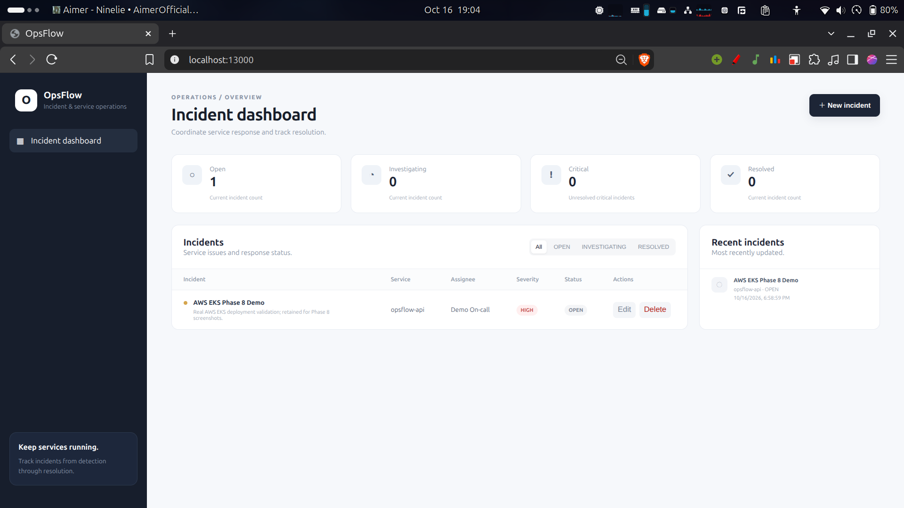

**Deployment record:** Minikube was the local Kubernetes validation environment. OpsFlow was also deployed to a temporary AWS EKS cluster. **After validation, the AWS infrastructure was destroyed with Terraform to prevent ongoing cloud charges.** The screenshots are historical evidence, not a live deployment.

[Complete rubric evidence](docs/EVIDENCE.md) · [Repository](https://github.com/Yuji25/OpsFlow) · [Recorded successful CI run](https://github.com/Yuji25/OpsFlow/actions/runs/38803999709)

## Key Features

- Incident CRUD with service, assignee, description, severity, status, and UTC timestamps.
- Open, Investigating, unresolved Critical, and Resolved KPI cards; status filters and recent activity.
- Severity/status badges, create/edit forms, delete confirmation, loading states, and backend-error retry.
- Validated API inputs, partial-field updates, and explicit 201/204/404/422 response handling.
- Health, database readiness, Prometheus metrics, and Swagger/OpenAPI endpoints.
- Responsive React interface with layouts for smaller screens.

## Architecture

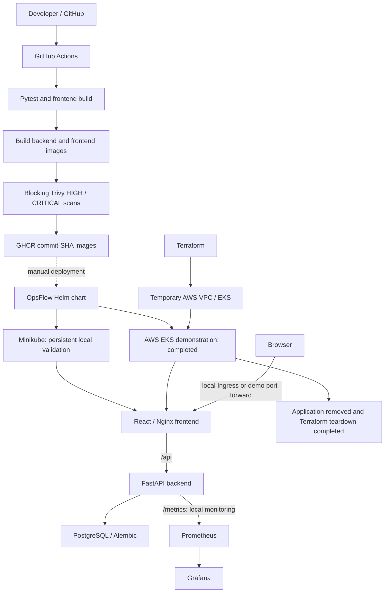

The application layer is shared across Compose, Minikube, and the completed EKS demonstration. Minikube used persistent PostgreSQL storage and Ingress; EKS used ephemeral PostgreSQL and port-forwarding. Prometheus/Grafana were validated on Minikube. GitHub Actions validates, scans, and publishes images; Kubernetes deployments were performed separately with Helm.

## Technology Stack

| Area | Technologies |
|---|---|
| Application | React, Vite, Nginx, FastAPI, SQLAlchemy, PostgreSQL, psycopg, Alembic |
| Testing | pytest, FastAPI TestClient/httpx, isolated SQLite |
| Containers | Docker, multi-stage frontend build, Docker Compose |
| CI/CD & security | GitHub Actions, Docker Buildx, GHCR, Trivy |
| Orchestration | Kubernetes, Helm, Minikube, Nginx Ingress, CPU HPA |
| Observability | Prometheus, Grafana, Prometheus FastAPI Instrumentator |
| Cloud / IaC | Terraform, AWS VPC, EKS managed node group, EC2 |

## Application and API

An incident contains `id`, `title`, `description`, `service`, `severity`, `status`, `assignee`, `created_at`, and `updated_at`.

Severity is `LOW`, `MEDIUM`, `HIGH`, or `CRITICAL`; status is `OPEN`, `INVESTIGATING`, or `RESOLVED`. The Critical KPI counts only unresolved critical incidents. Title and service must be nonblank; the backend validates allowed values and field lengths.

| Method | Endpoint | Purpose |
|---|---|---|
| GET | `/` | Service/version information |
| GET | `/health` | Liveness: `UP` |
| GET | `/ready` | PostgreSQL/table readiness: `READY` |
| GET | `/metrics` | Prometheus metrics |
| GET | `/docs`, `/openapi.json` | Swagger UI and API schema |
| GET | `/api/incidents` | List incidents, newest ID first |
| GET | `/api/incidents/stats` | Total and KPI counts |
| GET | `/api/incidents/{incident_id}` | Read an incident |
| POST | `/api/incidents` | Create an incident: 201 |
| PUT | `/api/incidents/{incident_id}` | Update supplied fields: 200 |
| DELETE | `/api/incidents/{incident_id}` | Delete: 204, empty body |

Missing resources return 404; invalid inputs return 422. Omitted PUT fields remain unchanged. [Backend implementation](backend/app/main.py) · [Schemas](backend/app/schemas.py) · [Initial migration](backend/alembic/versions/0001_create_incidents.py).

## Testing and Quality

The isolated suite contains **36 API test cases, including parametrized cases**, covering operational endpoints, CRUD, timestamps, status/severity combinations, invalid inputs, missing resources, ordering, and stats. Each test uses its own in-memory SQLite engine and dependency override; database and application-name environment settings are set before application imports.

The captured CI run reports **36 passed, 4 warnings**. The warnings concern deprecated dependency/startup APIs; the suite does not verify PostgreSQL-specific migration behavior, which was validated separately through the deployed stacks.

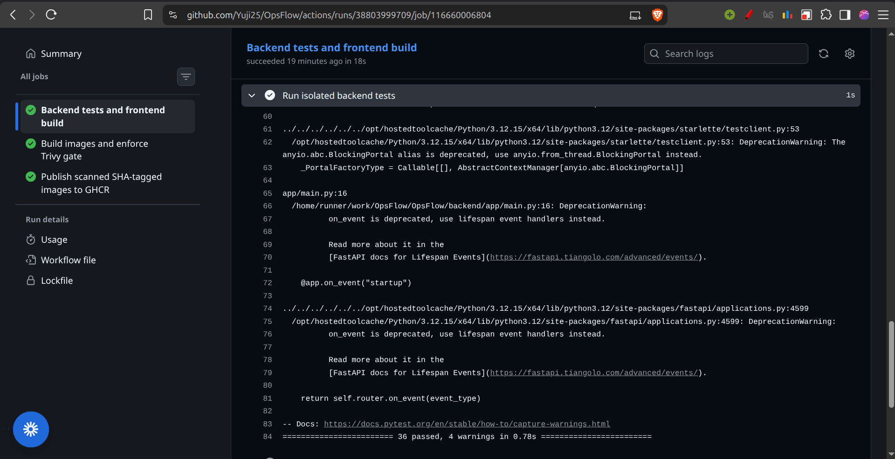

[Test suite](backend/tests/test_api.py) · [pytest configuration](backend/pytest.ini).

## Docker

[Compose](docker-compose.yml) runs PostgreSQL, the backend, and the frontend with `docker compose up --build`.

- The backend uses Python 3.12 Alpine, runs as UID 10001, and executes Alembic before Uvicorn.
- The frontend builds with Node and `npm ci`, then serves static assets through unprivileged Nginx on port 8080.
- PostgreSQL uses a named volume. Its `pg_isready` check gates backend startup; backend `/ready` gates frontend startup.
- Nginx proxies `/api/` to `backend:8000`. The browser and API are exposed locally on ports 3000 and 8000; PostgreSQL defaults to 5432.

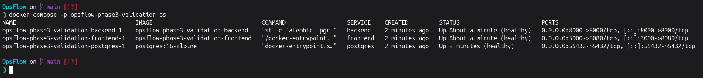

The screenshot used a separate validation project and PostgreSQL port 55432. Normal Compose defaults remain in the file. `docker compose down` retains the database volume; `down -v` deletes it. Bundled database credentials are disposable development defaults, not production credentials.

## CI/CD and DevSecOps

The [workflow](.github/workflows/ci.yml) runs on pushes to `main`, pull requests targeting `main`, and manual dispatch:

1. Python 3.12 installs backend requirements and runs pytest; Node 22 runs `npm ci` and the production frontend build.
2. Buildx builds both images. Trivy scans both; reports are printed and retained, including on failure.
3. Only successful main-branch push/manual runs in `Yuji25/OpsFlow` publish the exact scanned images to GHCR, without rebuilding. PR runs do not authenticate or publish.

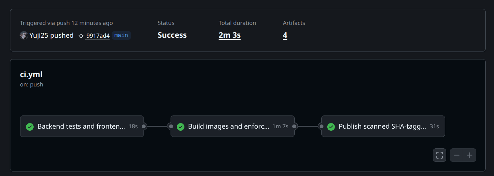

Trivy scans backend and frontend images for OS and library vulnerabilities. The workflow blocks HIGH/CRITICAL findings with `exit-code: 1` and `ignore-unfixed: false`, and publication requires both scans to pass. The captured reports show no findings within that severity scope at scan time; this does not establish that the images are free of all vulnerabilities.

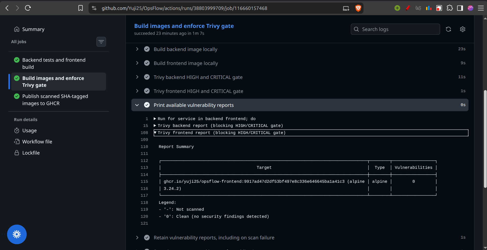

Images use full commit-SHA tags:

```text
ghcr.io/yuji25/opsflow-backend:<commit-sha>
ghcr.io/yuji25/opsflow-frontend:<commit-sha>
```

GHCR login uses the built-in `GITHUB_TOKEN`. Workflow permissions default to `contents: read`; only the guarded publication job has `packages: write`. There is no automatic Kubernetes/EKS deployment job and no `latest` image publication.

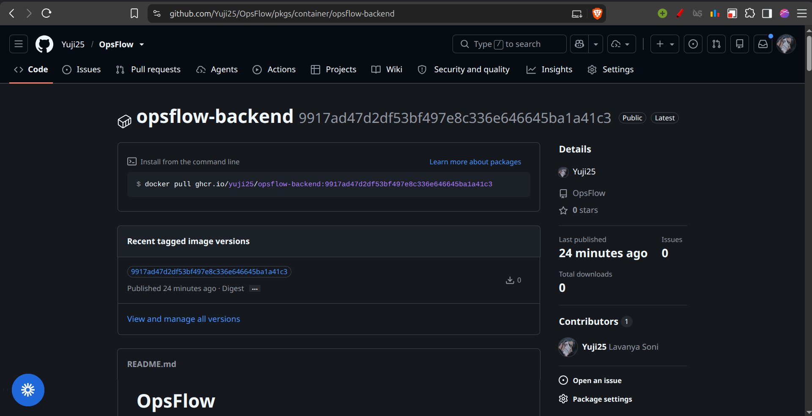

[Backend scan](screenshots/phase4-trivy-backend.png) · [Frontend package](screenshots/phase4-ghcr-frontend.png).

## Kubernetes and Helm

[The OpsFlow chart](helm/opsflow/) was validated in Minikube namespace `opsflow`, with two backend replicas, two frontend replicas, and one PostgreSQL replica.

| Component | Local configuration |
|---|---|
| Backend | ClusterIP Service `backend:8000`; `/health` liveness and `/ready` readiness |
| Frontend | ClusterIP Service `opsflow-frontend:80` targeting container port 8080 |
| PostgreSQL | Single Recreate Deployment, 2 GiB PVC; retention annotation on uninstall |
| Ingress | `opsflow.local`: `/` → frontend, `/api` and `/docs` → backend; exact operational/schema routes |
| HPA | Backend CPU target 70%, minimum 2 / maximum 4; CPU requests configured |
| Migrations | One revision-specific Job runs Alembic; backend init containers check the expected migration head |

Helm starts Uvicorn directly after the migration wait, avoiding per-replica migration execution. `--wait --wait-for-jobs` checks workloads and the migration Job. Finished migration Jobs expire after ten minutes.

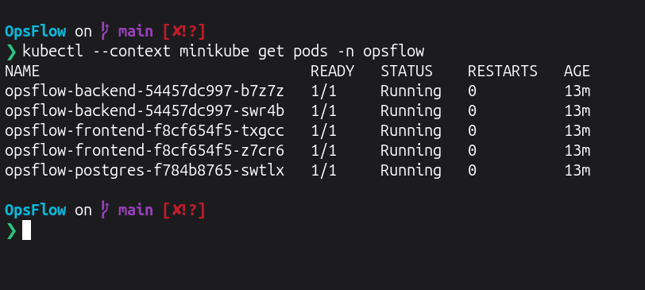

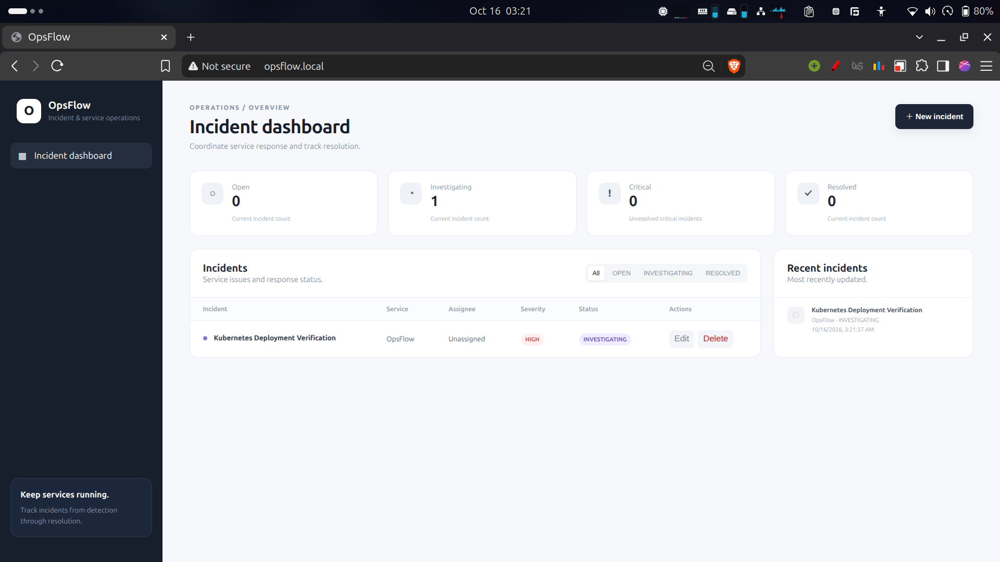

[Helm release](screenshots/phase5-helm-list.png) · [Successful upgrade history](screenshots/phase5-helm-history.png) · [Services, Ingress and PVC](screenshots/phase5-services-ingress-pvc.png) · [Numeric HPA metrics](screenshots/phase5-hpa.png).

## Observability

The backend exposes Instrumentator metrics at `/metrics`. Standalone **Prometheus chart 29.36.1** and **Grafana chart 13.5.0** were deployed in Minikube namespace `opsflow-monitoring`, using [repository-managed values and dashboard JSON](monitoring/).

Prometheus discovers Ready backend pods in `opsflow` and scrapes each replica independently every 15 seconds. Targets carry `job`, `namespace`, `pod`, and distinct `instance` labels; Prometheus also scrapes itself. Unneeded exporters, Alertmanager, and Pushgateway are disabled.

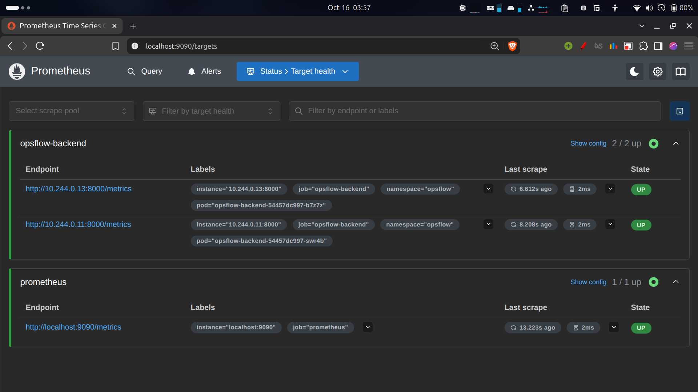

Grafana's datasource and seven-panel **OpsFlow Operations** dashboard are provisioned from files. Panels cover target health, API request rate/increase, method/status-class breakdown, mean latency by handler, and Python-process CPU/memory per pod. These use exposed metrics rather than invented incident or Kubernetes pod-resource metrics.

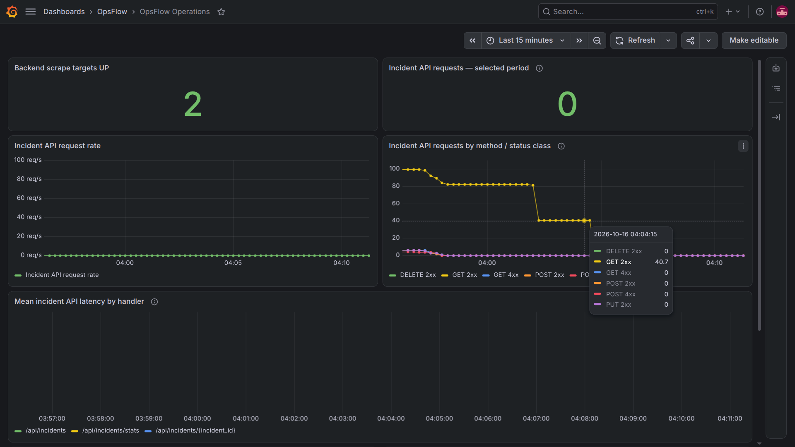

An idle window can have zero request rate or gaps in mean latency; windowed increases may be fractional. Process metrics are not total pod CPU/memory. Prometheus has a retained 2 GiB PVC and six-hour retention; Grafana storage is ephemeral because its datasource/dashboard are reproducibly provisioned. [Local monitoring setup](docs/EVIDENCE.md#reproducing-local-validation).

## AWS and Terraform

[Terraform](terraform/) provisioned a real temporary environment in **ap-south-1**: `opsflow-vpc`, two public subnets across two AZs, and EKS `opsflow-eks` on Kubernetes 1.36 with managed node group `opsflow-eks-demo`, using one On-Demand `t3.medium`.

The design enabled public subnet IP assignment and an Internet Gateway, with no NAT Gateway or private worker subnets. EKS enabled private API access and restricted public API access to an administrator CIDR. Worker configuration used a 20 GiB encrypted gp3 root disk, standard CPU credits, and disabled EC2 detailed monitoring; optional customer KMS/log-group resources were disabled.

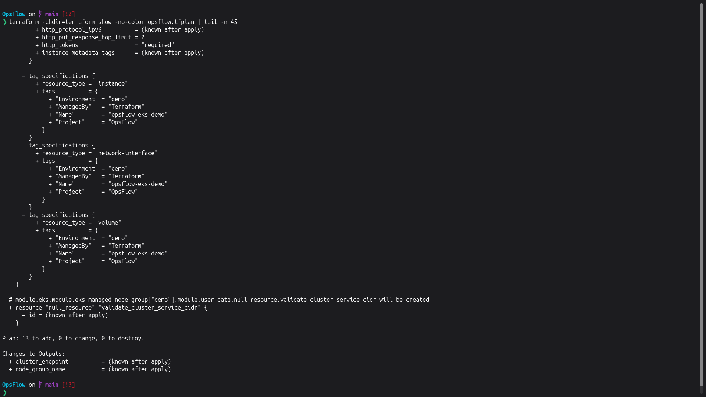

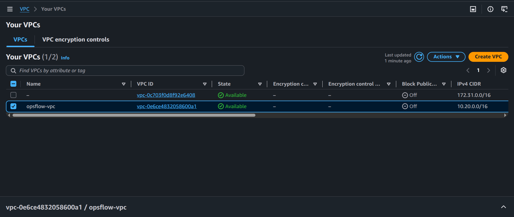

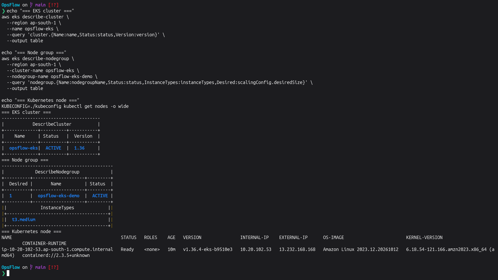

The [EKS demo override](helm/opsflow/values-eks-demo.yaml) retained two backend and two frontend replicas, used node-local ephemeral PostgreSQL `emptyDir`, and disabled Ingress/HPA. Services stayed ClusterIP; access used port-forwarding rather than a cloud load balancer. The captured API evidence shows health/readiness and retrieval of the real incident **AWS EKS Phase 8 Demo**, also visible in the dashboard above.

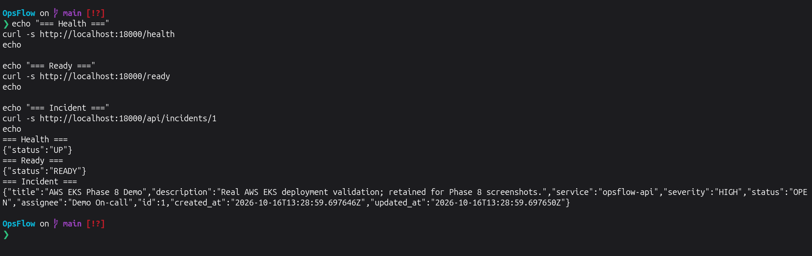

**After validation, the AWS infrastructure was destroyed with Terraform to prevent ongoing cloud charges.** AWS is not currently running. The final teardown capture records applying a saved destroy plan and removing the last two IAM roles; it is not a screenshot of the entire teardown in one command.

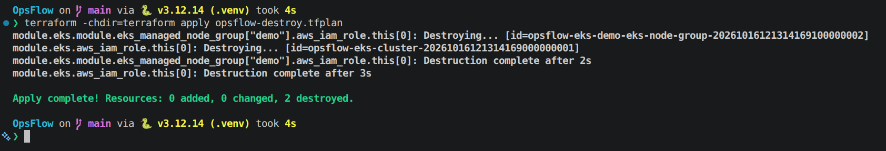

[Terraform reproduction and lifecycle guide](terraform/README.md) · [Complete AWS evidence and limitations](docs/EVIDENCE.md#m7--terraform--aws-infrastructure-as-code).

## Security and Operational Decisions

- Environment, credential, state, plan, and kubeconfig paths are excluded by ignore rules; provider checksums remain versioned.
- Application containers run without root; Kubernetes deployments preserve their non-root users.
- CI blocks HIGH/CRITICAL findings and publishes SHA-tagged images only after validation/scanning.
- Kubernetes database configuration uses a Secret; bundled database values remain demonstration defaults.
- Grafana generates its admin password in a Secret and disables anonymous access; monitoring uses local port-forwards.
- The application has no implemented authentication layer, and its permissive CORS/demo defaults require review before public production use.
- Local PVCs preserve demonstration data; AWS PostgreSQL was deliberately ephemeral. AWS infrastructure was removed after validation.

## Quick Start

**Prerequisites:** Docker Engine and Docker Compose for the simplest local path. Python 3.12 is needed for the isolated test suite; Node 22 is used by CI. Minikube additionally requires kubectl, Helm, and sufficient local resources.

```bash
docker compose up --build
```

Open `http://localhost:3000` for the dashboard and `http://localhost:8000/docs` for Swagger. If port 5432 is occupied, set `POSTGRES_PORT=55432`. Do not delete existing database volumes to resolve a port conflict.

Tests, from the repository root:

```bash
python3.12 -m venv backend/.venv
backend/.venv/bin/python -m pip install -r backend/requirements.txt
(cd backend && .venv/bin/python -m pytest -v)
```

For Minikube, enable the ingress and metrics-server addons, then:

```bash
kubectl --context minikube apply -f k8s/namespace.yaml
helm upgrade --install opsflow helm/opsflow --kube-context minikube -n opsflow \
  -f helm/opsflow/values-minikube.yaml --wait --wait-for-jobs --timeout 10m
```

Map the Minikube IP to `opsflow.local` for browser access. [Detailed local validation and monitoring commands](docs/EVIDENCE.md#reproducing-local-validation) · [AWS instructions and cost boundaries](terraform/README.md). AWS commands require new, explicitly authorized provisioning; the demonstrated cluster has been destroyed.

## Repository Structure

```text
backend/              FastAPI application, isolated tests, Alembic, Dockerfile
frontend/             React/Vite dashboard and Nginx container configuration
.github/workflows/    Validation, image builds, Trivy gate, GHCR publication
helm/opsflow/         Application chart; Minikube and ephemeral EKS overrides
k8s/                  Local namespace manifest
monitoring/           Prometheus/Grafana values and provisioned dashboard
terraform/            Temporary AWS VPC/EKS configuration and lifecycle guide
screenshots/          Captured implementation and validation evidence
docs/                 Rubric-aligned evidence index
troubleshooting/      Retained intentionally broken starter exercises
scripts/              Retained starter load-test helper
argocd/               ArgoCD Application manifest and GitOps documentation
demo/                 Final PPT, PDF and recorded project walkthrough
```

The troubleshooting examples retain TaskBoard names intentionally and are not deployment manifests. The load-test helper needs an explicit OpsFlow `URL` override because its retained default points to the starter route. No automated load-test outcome is claimed.

## Evidence / Grading

[docs/EVIDENCE.md](docs/EVIDENCE.md) maps M1–M10 to implementation files and captured screenshots. [Commit-history evidence](screenshots/final-commit-history.png) records **11 capstone commits** before this documentation change. Final presentation materials and the recorded walkthrough are available in [`demo/`](demo/).

## AWS Cost / Cleanup Note

The AWS demonstration infrastructure was destroyed after validation. Recreating it incurs EKS, worker, storage, public-IP, and potentially transfer charges; review current regional pricing and the teardown procedure before provisioning. The screenshots record completed work and do not advertise a currently available AWS endpoint.

## Known Limitations

- OpsFlow does not currently implement end-user authentication or authorization.
- The AWS EKS environment was intentionally destroyed after validation to prevent ongoing cloud charges; AWS screenshots are historical evidence.
- The EKS demonstration used ephemeral PostgreSQL storage, while the Minikube deployment uses persistent storage.
- Prometheus and Grafana were validated on Minikube rather than kept running as a permanent cloud monitoring stack.
- GitHub Actions validates, scans, and publishes images to GHCR; Kubernetes deployment is managed separately rather than automatically deployed by CI.
